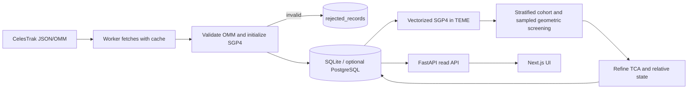

# Orbital Intelligence

Windows-first academic prototype for tracking public GP OMM element sets and finding geometric close approaches. **This is not an operational collision-avoidance system.** The UI repeats: *Indicative risk estimates from public data; not for operational maneuver decisions.* It intentionally reports no probability of collision (Pc) when the required encounter-plane relative covariance is absent.

## What works in this repository

- CelesTrak GP JSON/OMM retrieval with a six-hour file cache, descriptive User-Agent, bounded HTTP timeout, and mocked retrieval tests.
- OMM field/range/epoch validation and `sgp4.omm.initialize()` validation in the ingest worker; invalid rows are retained in `rejected_records`.
- SQLite-first SQLAlchemy models and an explicit Alembic initial migration. The DB path resolves to `backend/data/orbital_intelligence.db` under this repository, independent of the process working directory.
- Repeatable ingest, idempotent `(NORAD ID, epoch)` element storage, vectorized SGP4 propagation in TEME/km/km/s, a deterministic altitude/inclination-stratified screen cohort, 30-second candidate sampling, and bounded TCA refinement.
- API reads of persisted objects/events, freshness, pagination, object history, current ground-track coordinates, and factual database summaries. The API does not fetch CelesTrak or perform conjunction screening inside request handlers.
- Responsive Next.js pages for overview, objects, object details, geometric approaches, event detail, and descriptive insights.
- Explicit 2-D Gaussian encounter-plane Pc integration for scientific experiments only when the caller supplies a positive-definite relative covariance. No scalar error estimate is converted into a covariance.

The screen cohort is bounded by `MAX_SCREEN_OBJECTS` (default 500) to keep a local prototype tractable. The watchlist is retained; remaining objects are selected deterministically across altitude/inclination bins. Pipeline runs record how many were omitted. Events from this limited cohort are not catalog-wide screening results.

## Python 3.14 compatibility

The project keeps Python 3.14 as its target. Runtime dependencies are limited to FastAPI, Uvicorn, SQLAlchemy, Alembic, SGP4, Skyfield, NumPy, SciPy, APScheduler, HTTPX, and python-dotenv. ML packages from the old scaffold were removed because no validated error model is implemented. The declared versions have Python 3.14-compatible releases/wheels for the compiled libraries; SGP4 2.27 uses its stable ABI. Skyfield 1.55 is pure Python and publishes a universal `py3` wheel, although its PyPI classifiers currently list through 3.13, so 3.14 compatibility has not been directly exercised here. See the official [SGP4 package documentation](https://pypi.org/project/sgp4/), [Skyfield package files](https://pypi.org/project/skyfield/), [NumPy](https://pypi.org/project/numpy/), and [SciPy](https://pypi.org/project/scipy/).

There is no known required dependency that warrants switching to Python 3.12. This run could not install the requirements because DNS lookup for `pypi.org` failed (`getaddrinfo failed`). Do not interpret metadata review as a successful local wheel installation.

## First-run checklist (Windows Command Prompt)

Use the specified Python 3.14 installation and Node.js 24. Docker is not needed for local development.

```bat
cd /d D:\orbital_intelligence
python --version
node --version
npm --version
git status
python -m venv .venv
.venv\Scripts\activate
python --version
python -m pip install --upgrade pip
python -m pip install -r backend\requirements.txt
copy .env.example .env
```

Edit `.env` and replace the example contact address in `USER_AGENT` with a descriptive project contact. Leave the SQLite `DATABASE_URL` as provided, or remove that line to use the same default. Space-Track variables are optional placeholders; a `gp_history` connector is not implemented. Never commit `.env` or provider credentials.

Initialize/update the database from the repository root:

```bat
python -m alembic -c backend\alembic.ini upgrade head
```

Run the FastAPI server in this terminal:

```bat
python -m uvicorn app.api.main:app --app-dir backend --reload
```

The API is at [http://127.0.0.1:8000](http://127.0.0.1:8000) and interactive docs are at [http://127.0.0.1:8000/docs](http://127.0.0.1:8000/docs). Stop it with **Ctrl+C**. To restart, activate `.venv`, rerun the Alembic command above, then rerun the Uvicorn command.

### Fetch and screen public elements

In a second terminal, activate the same virtual environment and run one pipeline pass:

```bat
cd /d D:\orbital_intelligence
.venv\Scripts\activate
cd backend
python -m app.jobs.run_pipeline
```

This command fetches the configured CelesTrak groups on cache misses (default cache age six hours), validates and stores records, then propagates/screens the stored cohort for 72 hours. It needs an internet connection. Upstream failures are recorded per group; previously stored data and events remain available. The default group list is configurable in `.env`; avoid frequent polling. To run an ongoing worker instead, use `python -m app.jobs.scheduler` from the `backend` directory. Its first pass is immediate, then it runs every six hours. Stop with **Ctrl+C**.

### Frontend

In a third terminal:

```bat
cd /d D:\orbital_intelligence\frontend
npm install
npm run typecheck
npm run lint
npm run build
npm run dev
```

Open [http://localhost:3000](http://localhost:3000). `NEXT_PUBLIC_API_URL` defaults to `http://localhost:8000`; `CORS_ORIGINS` defaults to both localhost and 127.0.0.1 on port 3000. Stop the frontend with **Ctrl+C**. Restart with `npm run dev` from `frontend`.

## Tests and checks

From the repository root, with `.venv` active and backend requirements installed:

```bat
python -m pytest backend -q
python -m alembic -c backend\alembic.ini upgrade head
cd frontend
npm run typecheck
npm run lint
npm run build
```

The Python suite includes deterministic synthetic OMM records, mocked HTTP/cache tests, SQLite/API contract checks, migration tests, and SGP4/TCA tests. Synthetic fixtures are clearly labeled and are never displayed as live orbital data. CI targets Python 3.14 and Node 24. `python -m unittest discover -s tests -v` also runs the Python tests when launched from `backend`.

## Configuration

| Variable | Default | Effect |
|---|---|---|
| `DATABASE_URL` | SQLite at `backend/data/orbital_intelligence.db` | Relative SQLite paths resolve from the repository root. PostgreSQL is optional. |
| `USER_AGENT` | `OrbitalIntelligence/1.0 (academic public-data research)` | Sent with CelesTrak HTTP requests. Set an identifying contact in local `.env`. |
| `WATCHLIST` | `25544` | Comma-separated integer catalog IDs preferentially included in the local screen cohort. |
| `CELESTRAK_GROUPS` | stations, weather, gps-ops and two debris groups | GP JSON/OMM groups fetched by the background job. |
| `CELESTRAK_CACHE_SECONDS` | `21600` | Cache TTL in seconds. |
| `SCREEN_HOURS` | `72` | Forecast window. |
| `SCREEN_STEP_SECONDS` | `30` | Coarse sample interval; local minima are refined to 0.05 seconds numerically. |
| `COARSE_LIMIT_KM` | `600` | Retention radius for geometric candidates. Candidate search expands this by a documented speed bound to reduce between-sample misses. |
| `ELEMENT_STALE_HOURS` | `72` | Older source elements are marked inconclusive. |
| `MAX_SCREEN_OBJECTS` | `500` | Deterministic cohort cap; omitted count is logged. Must include the available watchlist. |
| `GROUNDTRACK_POINTS` | `120` | Default point count for on-demand Skyfield ground tracks. |
| `CORS_ORIGINS` | localhost:3000 and 127.0.0.1:3000 | Comma-separated browser origins. |
| `SPACETRACK_USER`, `SPACETRACK_PASS` | empty | Reserved for a future historical-data connector; currently unused. |

The previous `HARD_BODY_RADIUS_KM` and `RISK_THRESHOLDS` settings were removed from application config because a Pc/risk label cannot be justified from the available inputs.

## Flow



## Scientific scope and limitations

- SGP4 states are TEME; positions are km, velocities km/s, and propagation times are UTC. SGP4 itself does not output WGS84 latitude/longitude; Skyfield performs the ground-track conversion.
- The candidate search uses a 30 km/s relative-speed bound to widen the tree-search radius by half a sampling interval. It is a conservative engineering bound for the configured Earth-orbit screen, not a proof that every possible encounter is found. Finite windows and the cohort cap also limit coverage.
- Local minima are sampled on the coarse grid then refined with bounded golden-section minimization. This is numerical screening, not a certified conjunction assessment.
- Public GP element sets include no covariance. The next published set is not truth. A scalar position-error prediction is not a covariance. Therefore geometric events have `probability_of_collision = null`, `risk_level = "Geometric screen"`, and an explicit Pc-unavailable reason. They must not be ordered or described as risk levels.
- The standalone Pc integrator requires an externally justified 2-D relative encounter covariance in km² and an explicit hard-body radius in km. No pipeline source currently supplies that covariance, so the application never computes or displays Pc.
- No historical element-error dataset or trained uncertainty model exists yet. No ML performance metrics are claimed.
- Space-Track historical `gp_history`, object regime completeness, operator-provided covariance, and operational maneuver recommendation are not implemented.

## Optional PostgreSQL / Docker

SQLite is the default local workflow. For a future SQLAlchemy-compatible PostgreSQL deployment, install `backend/requirements-postgres.txt` and set `DATABASE_URL`. Docker and Compose are optional and require Docker Desktop; they use PostgreSQL and run Alembic before the API starts. Replace the development database password before deployment. On Render/Railway, run the worker as a separate service; use Vercel for the frontend and Supabase PostgreSQL if desired. Keep credentials in platform secret stores.

## Verification status from this implementation run

| Check | Actual result |
|---|---|
| Python version | 3.14.0 |
| `compileall` for backend app/tests | Passed |
| Offline host `unittest` suite | 11 passed, 5 skipped; the skips cover SGP4-dependent tests and the Alembic migration check because those packages are not installed |
| Pc 2-D quadrature vs isotropic exact reference fixture | Passed with supplied synthetic covariance |
| Python 3.14 venv | Created; bootstrap pip succeeded after directing temp files into the workspace |
| Backend package installation in venv | Failed: PyPI DNS lookup `getaddrinfo failed`; no claims of installation success |
| CelesTrak live retrieval | Not tested; only mocked retrieval/cache tests ran |
| SGP4/TCA propagation | Implemented and deterministic integration tests added, but not run without `sgp4` |
| Alembic migration | Explicit migration added, but not run without `alembic` |
| npm install / Next.js typecheck, lint, build | Not run successfully: `ENOTFOUND registry.npmjs.org`; frontend build remains unverified |
| Docker | Not run; Docker is not installed |
